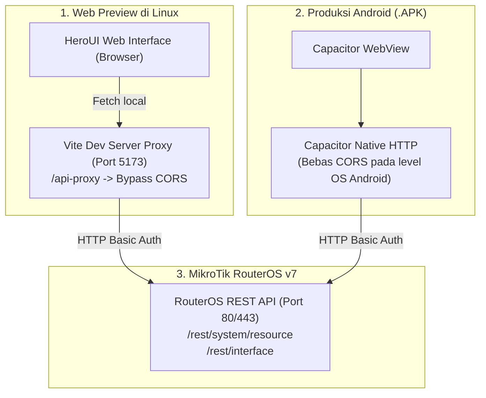

# Rencana Pengembangan Aplikasi MikroTik Monitor (HeroUI + React + Capacitor)

Aplikasi mobile Android (.apk) berbasis **React + HeroUI v3 + Tailwind CSS v4 + Capacitor** untuk monitoring perangkat **MikroTik RouterOS v7** via **REST API**.

---

## 1. Arsitektur Komponen & UI HeroUI

Aplikasi menggunakan komponen resmi dari **[HeroUI](https://heroui.com)** (`@heroui/react` & `@heroui/styles`):

- **Card (`Card`, `CardHeader`, `CardContent`, `CardFooter`):** Kontainer modular untuk form profil router dan metrik hardware.
- **Button (`Button`):** Tombol interaktif dengan variant `primary`, `secondary`, `outline`, dan `danger-soft`.
- **InputGroup (`InputGroup`, `InputGroup.Input`, `InputGroup.Prefix`, `InputGroup.Suffix`):** Field input modern dengan ikon prefix dan tombol suffix toggle password.
- **Chip (`Chip`, `ChipLabel`):** Badge penanda status koneksi (`Connected`, `Disabled`, `Link Down`, `Mode Setup`).
- **ProgressBar (`ProgressBar`, `ProgressBar.Track`, `ProgressBar.Fill`):** Visualisasi beban CPU, RAM, dan HDD yang halus.
- **Spinner (`Spinner`):** Indikator loading native HeroUI saat melakukan pengujian koneksi.

---

## 2. Arsitektur Jaringan & Build APK

---

## 3. Status Implementasi

- [x] Konfigurasi React 19 + HeroUI v3 + Tailwind CSS v4.
- [x] Form setup koneksi MikroTik (IP, Port, HTTP/HTTPS, User, Pass).
- [x] Multi-profil router di local storage.
- [x] Anti-CORS dev proxy untuk pengujian langsung dari browser Linux.
- [x] Dashboard metrik real-time (CPU Load, RAM, Storage, Uptime, Network Interfaces).
- [x] Audit kualitas desain Impeccable (0 anti-patterns, 0 advisories).
- [x] Konfigurasi Android Capacitor (`android:usesCleartextTraffic="true"`).
- [ ] Build file APK siap install (Debug/Release APK).
